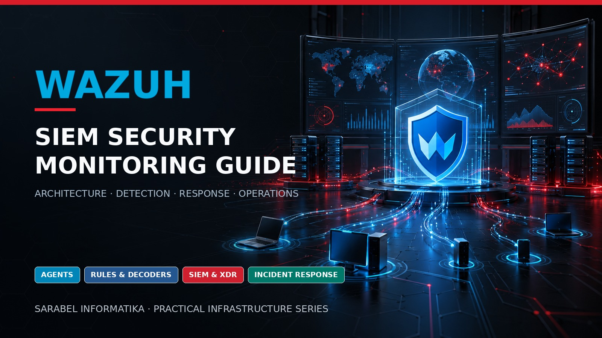

# Wazuh SIEM Security Monitoring Guide

<p align="center">
  
</p>


[](https://github.com/sarabelinformatika/wazuh-siem-security-monitoring-guide/actions/workflows/validate.yml)
[](https://github.com/sarabelinformatika/wazuh-siem-security-monitoring-guide/releases/tag/v1.0.0)
[](LICENSE)

A production-oriented architecture, deployment, security, detection-engineering, and operations guide for Wazuh SIEM/XDR. It covers agents, Wazuh server, indexer, dashboard, PKI, sizing, log sources, decoders, rules, FIM, vulnerability detection, SCA, Active Response, RBAC, alert triage, platform monitoring, snapshots, upgrades, disaster recovery, and evidence-based acceptance.

This independent guide is published by [SARABEL Informatika Kft.](https://sarabelinformatika.hu) as part of its practical infrastructure and cybersecurity series. For professional Wazuh architecture, deployment, integration, tuning, monitoring, incident readiness, and managed operations, visit [SARABEL Informatika](https://sarabelinformatika.hu).

> A populated dashboard is not a security outcome. Every source, detection, alert, response, retention rule, and exception needs an owner, a test, and recoverable evidence.

## Reference architecture

| Layer | Typical components | Primary objective |
|---|---|---|
| Endpoint | Wazuh agents, Syscollector, FIM, SCA | Collect attributable host telemetry |
| Analysis | Wazuh server cluster, decoders, rules | Normalize, correlate, and generate alerts |
| Data | Wazuh indexer cluster, lifecycle, snapshots | Searchable and recoverable evidence |
| Experience | Wazuh dashboard, API, RBAC | Controlled analysis and administration |
| Operations | External monitoring, case workflow, backup | Detect failure and sustain response |

## Guide map

1. [Scope, use cases, and detection strategy](docs/01-scope-use-cases-and-detection-strategy.md)
2. [Architecture, components, and trust boundaries](docs/02-architecture-components-and-trust-boundaries.md)
3. [Sizing, capacity, retention, and cost](docs/03-sizing-capacity-retention-and-cost.md)
4. [Secure installation, PKI, and component hardening](docs/04-secure-installation-pki-and-component-hardening.md)
5. [Agent enrollment, groups, and lifecycle](docs/05-agent-enrollment-groups-and-lifecycle.md)
6. [Log collection: syslog, Windows, Linux, and cloud sources](docs/06-log-collection-syslog-windows-and-cloud-sources.md)
7. [Decoders, rules, and detection engineering](docs/07-decoders-rules-and-detection-engineering.md)
8. [File integrity, malware signals, and threat intelligence](docs/08-file-integrity-malware-and-threat-intelligence.md)
9. [Syscollector, vulnerability detection, and SCA](docs/09-syscollector-vulnerability-detection-and-sca.md)
10. [Active Response safety and automation](docs/10-active-response-safety-and-automation.md)
11. [Indexer shards, lifecycle, and search performance](docs/11-indexer-shards-lifecycle-and-search-performance.md)
12. [Dashboard, API, RBAC, and identity integration](docs/12-dashboard-api-rbac-and-identity-integration.md)
13. [Alert triage, cases, notifications, and SOC workflow](docs/13-alert-triage-cases-notifications-and-soc-workflow.md)
14. [Monitoring the monitoring platform](docs/14-monitoring-the-monitoring-platform.md)
15. [Backup, snapshots, upgrade, and disaster recovery](docs/15-backup-snapshots-upgrade-and-disaster-recovery.md)
16. [Deployment, acceptance, operations, and improvement](docs/16-deployment-acceptance-operations-and-improvement.md)

## Included operational material

- Four read-only Wazuh assessment scripts
- Safe example log-source, retention, agent-group, rule, and decoder definitions
- Ports, controls, command catalogue, limitations, and official sources
- Architecture, detection, access, change, incident, recovery, and exception templates
- GitHub Actions validation for shell, YAML, XML, Markdown links, and common secret patterns

## Quick start

```bash
git clone https://github.com/sarabelinformatika/wazuh-siem-security-monitoring-guide.git
cd wazuh-siem-security-monitoring-guide
chmod +x scripts/*.sh
sudo ./scripts/wazuh-component-health-check.sh
sudo ./scripts/wazuh-agent-fleet-audit.sh
sudo ./scripts/wazuh-security-posture-check.sh
sudo ./scripts/wazuh-storage-capacity-check.sh
```

The scripts collect and display local state; they intentionally make no configuration changes. Review [SECURITY.md](SECURITY.md), [DISCLAIMER.md](DISCLAIMER.md), and [limitations](reference/limitations.md) before production use.

## Trademark notice

Wazuh is a trademark of Wazuh, Inc. This independent project is not an official Wazuh publication and is not endorsed by Wazuh, Inc.

## License

Released under the [MIT License](LICENSE).
